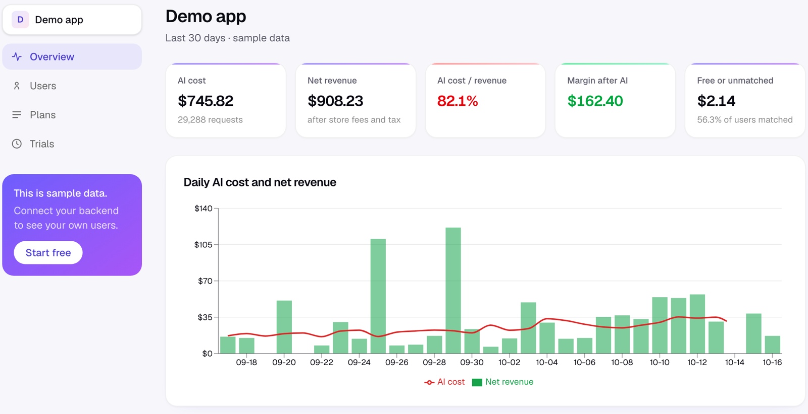

# FiscaLLM

[](https://github.com/magna56/fiscallm/actions/workflows/ci.yml) [](LICENSE) [](https://www.npmjs.com/package/fiscallm) [](https://pypi.org/project/fiscallm/)

**See the AI cost of every single user.** FiscaLLM adds up what each user costs you in AI and sets it next to what they pay you, so you can see who is profitable and who is losing you money.

**Open source (MIT) and free.** Use the hosted service at [fiscallm.com](https://fiscallm.com) (free under fair use, best effort), or [run your own](SELF-HOSTING.md).

[Live demo (no sign-up)](https://fiscallm.com/demo) · [Docs](https://fiscallm.com/docs) · [How it works](https://fiscallm.com/how-it-works) · [What it covers](https://fiscallm.com/coverage) · [Accuracy](ACCURACY.md) · [Roadmap](ROADMAP.md) ([board](https://github.com/users/magna56/projects/1)) · [Changelog](CHANGELOG.md) · [Self-hosting](SELF-HOSTING.md) · [Contributing](CONTRIBUTING.md)



*Sample data from the demo, not a real customer.*

## Get started in three steps

1. **Create an app** at [fiscallm.com](https://fiscallm.com) (or your own copy) and copy the ingest key.
2. **Add one line after each AI call** (it reads only the model name and token counts, never prompts or answers):

   ```ts
   import { createMeter } from "fiscallm"; // npm install fiscallm   (Python: pip install fiscallm)
   const meter = createMeter({ apiKey: process.env.FISCALLM_KEY, waitUntil });

   const res = await openai.chat.completions.create({ model, messages });
   meter.trackOpenAI(res, { userId, feature: "chat" });
   ```

3. **Connect revenue**: press **Connect RevenueCat** (one click: adds the webhook and imports past subscribers), paste a Stripe webhook URL, or send payments yourself with the revenue API.

No AI key handy? `FISCALLM_KEY=fsk_... node examples/send-sample-data.mjs` fills a test app with sample users so you can see it working.

## The problem

AI apps charge a flat price but pay a variable cost. One user costs $0.20 a month in AI, another costs $25. Your AI provider's bill shows tokens, your subscription tool shows payments, and neither shows the user.

## How it works

```ts
import { createMeter } from "fiscallm";

const meter = createMeter({ apiKey: process.env.FISCALLM_KEY, waitUntil });

const res = await openai.chat.completions.create({ model, messages });
meter.trackOpenAI(res, { userId, feature: "chat" });
```

```python
from fiscallm import Meter

meter = Meter(api_key=os.environ["FISCALLM_KEY"])
res = client.chat.completions.create(model=model, messages=messages)
meter.track_openai(res, user_id=user_id, feature="chat")
```

- The SDK reads **only the model name and token counts** from the response. Never prompts or answers.
- Events are batched and sent in the background. Tracking never throws and never blocks your response.
- Each event has a client-generated UUID, so retries cannot double count.
- Revenue comes from RevenueCat (one-click OAuth connect, or a webhook you add by hand), or from your own code with `trackRevenue` / `track_revenue`.
- Both are joined on the user ID. RevenueCat aliases are resolved, so anonymous and logged-in users merge.
- **Budgets and alerts**: email, Slack or signed webhooks when a user goes over budget, when a paying user loses money, or when one user burns a huge number of tokens in 5 minutes (a runaway loop).
- **Jobs** (pay-per-job apps, e.g. credits for a video render): tag AI calls with a `jobId` and report each job as pending, captured or refunded with `meter.trackJob` / `track_job`. The Jobs page shows the AI cost of refunded jobs and of jobs that never resolved, per user.
- **Spending caps**: mark a per-user budget as Block and call `meter.check(userId)` before an AI call (TypeScript, Python). It says no once the user reaches the amount, If FiscaLLM is slow or down, a user it already refused stays refused; anyone else is allowed by default (or refused, with `checkOnError: "deny"`). An optional **local limit** counts each user's calls and tokens in your process, so a runaway loop is stopped even with no network.

Cost is priced on arrival: exact `costUsd` if given, otherwise per-token (input, output, cache read and cache write priced separately) or per-unit (images, audio, video) from a price table. Unknown models are flagged as unpriced, never counted as zero.

Net revenue is `price × (1 − tax − store commission)`.

## Layout

| Path | What it is |
|---|---|
| `apps/web` | Next.js site and dashboard |
| `apps/api` | Hono API: ingest, RevenueCat webhook, revenue API, cron jobs |
| `packages/shared` | Drizzle schema, pricing, metrics, alerts |
| `packages/sdk` | TypeScript SDK (`fiscallm` on npm) |
| `packages/sdk-python` | Python SDK (`fiscallm` on PyPI) |

Stack: TypeScript, Next.js, Hono, Postgres (Supabase) with Drizzle, hosted on Vercel.

## Limits

- It needs a backend between your app and the AI provider. Apps that call a provider straight from the phone are not covered yet.
- Revenue comes from RevenueCat, Stripe (beta, USD only) or the revenue API. Direct App Store and Google Play connections are not built yet.

## Try it in ten minutes

- No AI key needed: `FISCALLM_KEY=fsk_... node examples/send-sample-data.mjs` fills the dashboard with sample users (one heavy user who loses money).
- Copy-paste starting points for [Next.js](examples/nextjs) and [FastAPI](examples/fastapi), see [examples](examples).
- Run your own copy: [](https://vercel.com/new/clone?repository-url=https%3A%2F%2Fgithub.com%2Fmagna56%2Ffiscallm&project-name=fiscallm&repository-name=fiscallm&env=DATABASE_URL,NEXT_PUBLIC_SUPABASE_URL,NEXT_PUBLIC_SUPABASE_PUBLISHABLE_KEY,CRON_SECRET,PUBLIC_URL&envDescription=Supabase%20connection%20details%2C%20a%20random%20CRON_SECRET%20and%20your%20public%20URL&envLink=https%3A%2F%2Fgithub.com%2Fmagna56%2Ffiscallm%2Fblob%2Fmain%2FSELF-HOSTING.md) (create a Supabase project first, see [SELF-HOSTING.md](SELF-HOSTING.md)).

## Development

```sh
pnpm install
pnpm dev:web   # http://localhost:3000
pnpm dev:api   # http://localhost:8787/api/health
pnpm test
```

Copy `.env.example` to `apps/web/.env.local` and `packages/shared/.env` and fill in the values.

```sh
pnpm db:generate
pnpm db:migrate
```

## Contributing

Issues and pull requests are welcome. Read [CONTRIBUTING.md](CONTRIBUTING.md) first (it includes a short contributor agreement). The plan, including what we only build if there is demand, is in [ROADMAP.md](ROADMAP.md), with a [public board](https://github.com/users/magna56/projects/1). Vote with a 👍 on [roadmap issues](https://github.com/magna56/fiscallm/issues?q=is%3Aissue+is%3Aopen+label%3Aroadmap) or share ideas in [Discussions](https://github.com/magna56/fiscallm/discussions/categories/ideas).

**Where help is most wanted:** prices for more models and providers (data only, no code knowledge needed), connectors for other billing systems (Adapty, Superwall), examples for AI frameworks, and a comparison of computed costs with a real provider invoice. See the [good first issues](https://github.com/magna56/fiscallm/issues?q=is%3Aissue+is%3Aopen+label%3A%22good+first+issue%22).

## Built by

Built and maintained by [Mayur](https://www.linkedin.com/in/mayur-agnani/) as an independent, open-source side project. Questions, bugs and ideas: [open an issue](https://github.com/magna56/fiscallm/issues) or email theaicommit@gmail.com.

## Contributors

Thank you to everyone who helps. [Contribute](CONTRIBUTING.md): a good place to start is an issue labelled `good first issue`.

<a href="https://github.com/magna56/fiscallm/graphs/contributors"></a>

## License

MIT. See [LICENSE](LICENSE).
